

  

# Nvisions R&D

어둠속의대화(Dialogue in the Dark) 한국 운영사 **㈜엔비전스**의 개발 조직입니다.
빛이 완전히 사라진 공간에서의 100분, 그 여행의 앞과 뒤를 소프트웨어로 잇습니다.

The engineering team of **Nvisions**, the Korean operator of Dialogue in the Dark. We build everything around the 100‑minute journey in complete darkness — before, during and after the visit.

## 만드는 것

| | |
|---|---|
| **방문자 사이트** | 예매 확인 · 개인정보 동의 · 입장 대기 화면 · 방명록 · 어둠 속에서 찍힌 사진의 미술관 · 내 여행 기록 |
| **운영 콘솔** | 회차 · 동의서 · 후기 · 사진 · 알림 · 재고를 한곳에서 |
| **연동·자동화** | 예매 플랫폼 연동, 관람 전후 카카오톡 알림, 매장 POS 연동 |
| **현장 도구** | 로비 안내 화면, 어둠 속 카메라 촬영 프로그램 |

## 기술 스택

  

<!-- stats:start -->
## 기여 현황 · 조직 전체 (최근 1년)

<picture><source media="(prefers-color-scheme: dark)" srcset="stats/org-dark.svg"></picture>

<table><tr>
<td><picture><source media="(prefers-color-scheme: dark)" srcset="stats/org-3d-dark.svg">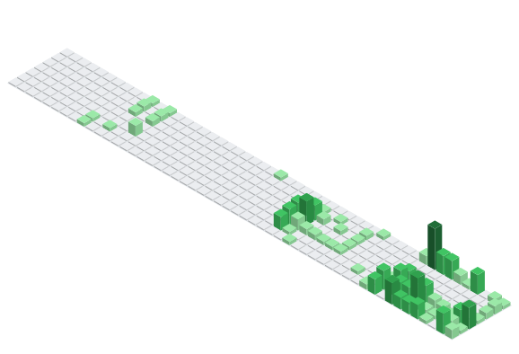</picture></td>
<td valign="top">

**Commit streaks** Current streak 10 days Best streak 10 days

**Commits per day** Highest in a day at 44 (2026-08-09) Average per active day at ~9.96

**Total** 747 commits · 75 active days · 11 repositories

</td></tr></table>

## 저장소별 커밋 현황 (이름순, 최근 1년)

| 저장소 | 언어 | 커밋 | 활동일 | 최근 push | 설명 |
|---|---|---:|---:|---|---|
| [at-server](https://github.com/Nvisions-RND/at-server) | TypeScript | 49 | 11 | 2026-04-05 | Automated trading brokerage server |
| [cafe24-legacy](https://github.com/Nvisions-RND/cafe24-legacy) | JavaScript | 1 | 1 | 2026-09-11 |  |
| [did-daily](https://github.com/Nvisions-RND/did-daily) | TypeScript | 158 | 27 | 2026-10-09 |  |
| [did-dstory](https://github.com/Nvisions-RND/did-dstory) | TypeScript | 42 | 12 | 2026-10-10 |  |
| [did-optical](https://github.com/Nvisions-RND/did-optical) | TypeScript | 4 | 3 | 2026-10-10 |  |
| [did-worker](https://github.com/Nvisions-RND/did-worker) | TypeScript | 237 | 48 | 2026-10-10 |  |
| [didark-site-collab](https://github.com/Nvisions-RND/didark-site-collab) | Java | 2 | 1 | 2026-09-24 | 어둠속의대화 홈페이지 소스 코드 수정 협업 |
| [infra](https://github.com/Nvisions-RND/infra) | Shell | 8 | 4 | 2026-10-09 | 엔비전스 공용 인프라 — WireGuard VPN 절차·스크립트, AWS 비용 알람(CDK) |
| [nvisions.co.kr](https://github.com/Nvisions-RND/nvisions.co.kr) | TypeScript | 6 | 2 | 2026-09-12 |  |
| [nvlink](https://github.com/Nvisions-RND/nvlink) | TypeScript | 236 | 25 | 2026-10-10 |  |
| [okpos-lambda](https://github.com/Nvisions-RND/okpos-lambda) | TypeScript | 4 | 2 | 2026-09-17 | OKPOS(okasp) 로그인·판매 조회를 대신 두드리는 AWS Lambda |

<b>at-server</b> · 49 commits · 최근 push 2026-04-05

<picture><source media="(prefers-color-scheme: dark)" srcset="stats/at-server-dark.svg"></picture>

<b>cafe24-legacy</b> · 1 commits · 최근 push 2026-09-11

<picture><source media="(prefers-color-scheme: dark)" srcset="stats/cafe24-legacy-dark.svg"></picture>

<b>did-daily</b> · 158 commits · 최근 push 2026-10-09

<picture><source media="(prefers-color-scheme: dark)" srcset="stats/did-daily-dark.svg"></picture>

<b>did-dstory</b> · 42 commits · 최근 push 2026-10-10

<picture><source media="(prefers-color-scheme: dark)" srcset="stats/did-dstory-dark.svg"></picture>

<b>did-optical</b> · 4 commits · 최근 push 2026-10-10

<picture><source media="(prefers-color-scheme: dark)" srcset="stats/did-optical-dark.svg"></picture>

<b>did-worker</b> · 237 commits · 최근 push 2026-10-10

<picture><source media="(prefers-color-scheme: dark)" srcset="stats/did-worker-dark.svg"></picture>

<b>didark-site-collab</b> · 2 commits · 최근 push 2026-09-24

<picture><source media="(prefers-color-scheme: dark)" srcset="stats/didark-site-collab-dark.svg"></picture>

<b>infra</b> · 8 commits · 최근 push 2026-10-09

<picture><source media="(prefers-color-scheme: dark)" srcset="stats/infra-dark.svg"></picture>

<b>nvisions.co.kr</b> · 6 commits · 최근 push 2026-09-12

<picture><source media="(prefers-color-scheme: dark)" srcset="stats/nvisions.co.kr-dark.svg"></picture>

<b>nvlink</b> · 236 commits · 최근 push 2026-10-10

<picture><source media="(prefers-color-scheme: dark)" srcset="stats/nvlink-dark.svg"></picture>

<b>okpos-lambda</b> · 4 commits · 최근 push 2026-09-17

<picture><source media="(prefers-color-scheme: dark)" srcset="stats/okpos-lambda-dark.svg"></picture>

매일 자동 갱신 — 마지막 갱신 2026-10-10 12:33 KST · 기본 브랜치의 최근 52주 커밋(GitHub commit_activity)
<!-- stats:end -->

## 연락

- 웹 [nvisions.co.kr](https://nvisions.co.kr) · 어둠속의대화 [dialogueinthedark.kr](https://dialogueinthedark.kr)
- 메일 wonseok.choi@nvisions.co.kr
