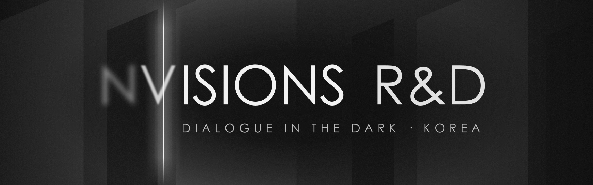

  

# Nvisions R&D

어둠속의대화(Dialogue in the Dark) 한국 운영사 **㈜엔비전스**의 개발 조직입니다.
빛이 완전히 사라진 공간에서의 100분, 그 여행의 앞과 뒤를 소프트웨어로 잇습니다.

The engineering team of **Nvisions**, the Korean operator of Dialogue in the Dark. We build everything around the 100‑minute journey in complete darkness — before, during and after the visit.

## 기술 스택

  

<!-- stats:start -->
## 기여 현황 · 조직 전체 (최근 1년)

<picture><source media="(prefers-color-scheme: dark)" srcset="stats/org-dark.svg"></picture>

<table>
<tr><th width="253">Commit streaks</th><th width="253">Commits per day</th><th width="253">Total</th></tr>
<tr><td align="center">Current <b>11 days</b> Best <b>11 days</b></td><td align="center">Highest <b>44</b> (2026-08-09) Average <b>~10.09</b> per active day</td><td align="center"><b>767</b> commits <b>76</b> active days · <b>12</b> repositories</td></tr>
</table>

매일 자동 갱신 — 마지막 갱신 2026-10-11 16:02 KST · 기본 브랜치의 최근 52주 커밋(GitHub commit_activity)
<!-- stats:end -->

## 연락

웹 [nvisions.co.kr](https://nvisions.co.kr) · 어둠속의대화 [dialogueinthedark.kr](https://dialogueinthedark.kr) · 메일 wonseok.choi@nvisions.co.kr
